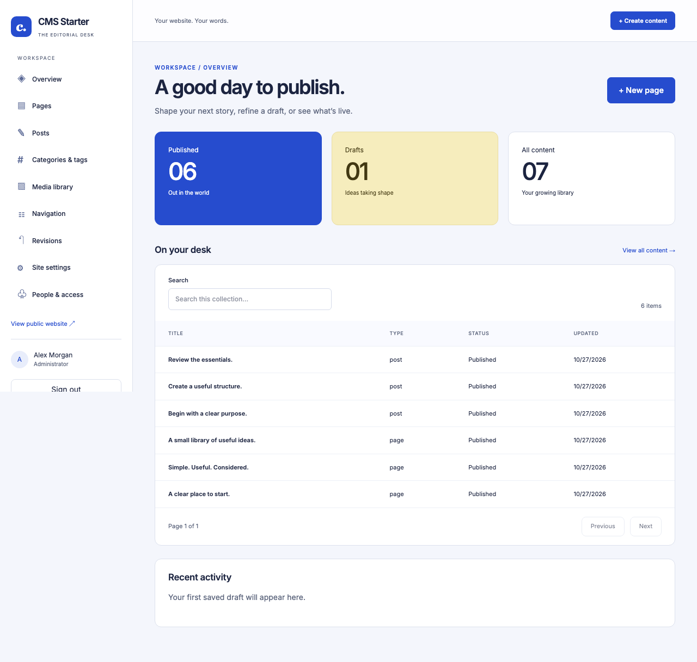

# CMS Starter

An Onyx-backed editorial CMS and public website in **one Next.js / Node.js application**, derived directly from `seo-starter`. A new cobalt-and-paper theme gives the editorial desk its own identity: light surfaces, blue navigation and actions, and pale yellow draft highlights.



Manage pages, posts, categories/tags, media, navigation, settings, team roles and revision history. No hosted CMS, paid editor subscription, external vector database, separate backend or hosting adapter is required. The locally integrated libraries are open source; your existing Onyx/Firebase service plans govern their hosted services.

## Derivation and architecture

This project copies and extends the actual `seo-starter`; it has no runtime sibling imports and leaves the original unchanged. Preserved foundations:

- Server-rendered public pages, readable HTML, native navigation and pagination.
- Trusted canonical origin, metadata, social cards, escaped JSON-LD and breadcrumbs.
- Publication-aware navigation, robots, sharded sitemaps, responsive images and locally bundled Inter font.
- Official Onyx SDK adapter using its existing downloaded-config resolver.
- Immutable `PageRevision` / typed `PageNode` content, insert-only URL claims, publication manifests and durable page locks.
- React server rendering of validated structured content, public bundle isolation, accessibility and Lighthouse checks.

The source already has a capable **Lexical** editor and static React renderer. Following the spec's instruction to reuse an existing editor, this derivative extends them with tables, undo/redo and CMS controls instead of installing a competing Tiptap editor or using Tiptap's incompatible renderer. Public pages load neither editor. Only allowlisted structured nodes are accepted; no author HTML, JavaScript, MDX, embeds or arbitrary CSS is executed.

| Location                       | Responsibility                                                                           |
| ------------------------------ | ---------------------------------------------------------------------------------------- |
| `app/(public)/`, `components/` | Public SSR presentation and search                                                       |
| `app/admin/`, `admin/`         | Protected editorial interface; lazy-loaded Lexical editor                                |
| `app/api/admin/`               | Session, same-origin and runtime validation, then service delegation                     |
| `lib/domain.ts`                | Validated typed records and document format                                              |
| `lib/publication.ts`           | Inherited immutable snapshots, route claims, publication pointers and public eligibility |
| `lib/cms/service.ts`           | Role/owner checks, working drafts, editorial actions, media, users and settings          |
| `lib/auth/`                    | Firebase client/Admin and active Onyx CMS grants                                         |
| `lib/repository.ts`            | Server-only official Onyx SDK adapter                                                    |
| `lib/seo.ts`, `lib/sitemap.ts` | Existing metadata, structured data and XML utilities                                     |
| `scripts/`                     | Explicit schema, seed, administrator bootstrap, identity and recovery tools              |
| `tests/`                       | Inherited and new unit/browser tests; isolated transport and official Auth Emulator      |

## Local setup

Use **Node 24.12+** (`.nvmrc`: 24.22.1), npm and an Onyx database supporting insert-only writes (Onyx 4.2.9+). Keep this independent starter's data in its intended CMS database; do not apply its extended schema to an existing SEO site's database without a reviewed migration.

```sh
npm ci
cp .env.example .env.local
npm run template:init -- --name "Your Journal" --slug your-journal
```

Fill `.env.local` with your application's Firebase public settings, Firebase Admin credentials, exact `APP_ORIGIN` and the **existing downloaded Onyx configuration** path. The official SDK resolves `ONYX_CONFIG_PATH`, project downloaded configs or the existing home profile. No browser database credentials or alternative key flow is introduced.

Next loads `.env.local`; CLI tools need those variables in their environment. For example:

```sh
node --env-file=.env.local --import tsx scripts/schema.ts validate
node --env-file=.env.local --import tsx scripts/schema.ts diff
# Review the diff in the intended database, then explicitly publish:
node --env-file=.env.local --import tsx scripts/schema.ts publish
node --env-file=.env.local --conditions=react-server --import tsx scripts/seed.ts
node --env-file=.env.local --conditions=react-server --import tsx scripts/site.ts --origin https://your-domain.example
npm run dev
```

Open http://127.0.0.1:3000 for the website and `/admin` for the editorial desk. Missing configuration produces setup/error guidance, never invented content or a memory fallback. Schema/seed/bootstrap do not run during startup or builds.

### Authentication and administrator bootstrap

Use your **application** Firebase project; an Onyx platform/private-workspace identity does not automatically grant CMS access. Existing downloaded Onyx credentials remain server-only persistence credentials, not a browser session or editor grant.

1. Enable Firebase Email/Password authentication and authorize your local/production domain.
2. Configure `NEXT_PUBLIC_FIREBASE_*` at build time. Configure matching `FIREBASE_PROJECT_ID` and Firebase Admin Application Default Credentials, or a base64 service account via `FIREBASE_SERVICE_ACCOUNT_BASE64`.
3. Create the initial user through your controlled Firebase account process and verify its email. The starter does not ship a production password, header bypass or public CMS-registration endpoint.
4. Set `CMS_ADMIN_EMAIL` to that existing verified user's email, then run:

```sh
node --env-file=.env.local --conditions=react-server --import tsx scripts/bootstrap-admin.ts
```

Bootstrap is idempotent for the initial active administrator. It refuses to promote a different account after an administrator exists. Further grants are managed by an authenticated administrator at **People & access**, using existing verified Firebase accounts. The last active administrator cannot be removed. Disabling a Firebase account or Onyx grant revokes subsequent protected requests.

| Role          | Server-enforced permissions                                                                                                                                 |
| ------------- | ----------------------------------------------------------------------------------------------------------------------------------------------------------- |
| Administrator | All content, publishing, media, taxonomy, navigation, settings and user grants                                                                              |
| Editor        | All content, publishing, taxonomy, navigation and media; no site settings or user management                                                                |
| Author        | Create/edit/preview/duplicate own drafts and manage their own draft images; no publishing, archiving, taxonomy changes, navigation, settings or user grants |

Authorization precedes private reads and writes, including previews, record IDs, revisions and media. Every mutation also requires the exact configured same-origin `Origin`; hidden controls never authorize an operation.

### Isolated local preview

```sh
npm run test:preview
```

Requires Java 21+ for Firebase Auth Emulator. Starts an explicit test-only Onyx HTTP transport, seeds it **through the official SDK**, starts the official Auth Emulator on 9299, builds Next with its public test Firebase settings, then serves the production app on **http://127.0.0.1:3040**.

Sign in at `/admin` with `admin@example.test`, `editor@example.test`, or `author@example.test`; password: `development-test-password`. These verified identities and grants exist only in the isolated fixture. Application session verification and authorization still run; there is no runtime auth bypass. The in-memory HTTP fixture lives only under `tests/`, is not an application fallback, and loses data on exit. No live Onyx/Firebase production records are touched. Stop with Ctrl-C.

## Editorial workflow

- **Create draft** persists a new page or post with an immutable initial revision. Titles, full paths, excerpts, attribution, featured/social images, categories/tags, metadata, publication-date metadata and layout are editable.
- **Autosave** waits 1.8 seconds after changes. It updates a temporary `WorkingDraft` and typed `DraftNode` set, not permanent revision history. Obsolete temporary node sets are removed after a successful checkpoint. Failed saves preserve the editor's current text; stale tokens produce a visible Conflict state and pause autosaving. Compare the saved draft in another tab before refreshing or making an explicit retry. There is no automatic overwrite/merge.
- **Save revision** creates a meaningful immutable history boundary. **Preview draft** reads the current working draft using the same content renderer as public pages. Preview is session/owner protected, visibly marked, uncached and noindex, with an exit link. No draft-mode cookie is used as authorization.
- **Publish** saves a complete immutable snapshot, validates referenced images and taxonomy, claims the path and builds the publication manifest before switching the public pointer. Editing any published page, slug or SEO field stays private until Publish. The publication-date field is metadata; future dates do not schedule a job.
- **Unpublish** removes the live pointer. **Archive** unpublishes and moves the item out of active editing; restoring an archive returns an unpublished draft.
- **Restore as draft** copies an authorized prior revision into a new saved draft, preserving the current live version until another publication.
- **Duplicate** creates a private copy and independently clones referenced Onyx media. It never reuses another page's image ownership or publishes a copy automatically.

The editor supports paragraphs, headings, bold/italic, links, ordered/unordered lists, quotes, code blocks, images, tables and undo/redo. Documents are versioned and bounded to 256 nodes/eight levels. Tables have bounded spans and must match the editor/renderer structure. New extensions must be added to Lexical, `DocumentSchema`, typed node persistence and `components/content.tsx` together.

### Slugs, navigation, SEO and freshness

Routes are normalized and system paths (admin/API/auth/preview/media/search/feed/SEO endpoints) are reserved. Insert-only Route IDs prevent collisions. Initial draft paths reserve their URL; edited paths are claimed at publication. An edited draft URL cannot become a redirect before publication. Historical public paths point directly to the page's current published canonical URL through its immutable path manifest, preventing redirect chains/loops. Reserved paths remain owned after unpublishing/archiving.

Navigation stores **content references** and resolves the current published URL. Draft-only and archived/unpublished items stay hidden. Categories/tags are managed editorial records attached to immutable revisions; archiving terms preserves history and prevents selecting them for a new publication. Metadata uses the existing trusted site-origin mechanism; canonical overrides are restricted to paths on that configured site. Social images must belong to the content item or be explicitly selected site defaults.

Only eligible published revisions enter public search, RSS at `/feed.xml`, collection pages and sitemap shards. Public noindex pages can remain in navigation, as in the source starter, but stay out of discovery indexes/search/feed. Admin, private media and previews are noindex/no-store. This does not make a public website private: use real authentication/network controls for confidential deployments.

Public content remains **uncached across requests/instances**, with React request-level deduplication only. Therefore publish/unpublish is visible on the next database read across all instances. CMS publication/settings/navigation/media actions also call the installed Next.js `revalidatePath` APIs for the root layout and derived endpoints; no process-local cache is claimed as distributed invalidation. An in-flight public render may finish using its already captured revision.

## Media and settings

Uploads use Onyx document storage and typed Media records. Only actual PNG/JPEG/WebP up to 5 MiB and 4096×4096 are accepted; active SVG, unsupported/animated content and mismatched MIME signatures are rejected. Sharp normalizes orientation and strips embedded metadata. Names are sanitized; alt text is required. The library shows dimensions, private/public eligibility and owning content, with thumbnail, caption/alt editing, upload, selection and removal controls.

Draft images require a verified session plus permission for the owning content. Public delivery rechecks the current publication or explicit site-logo/social-image setting on every request, uses bounded responsive transforms and no-store headers, and avoids a shared optimizer retaining revoked assets. A published page's body image alt text is revisioned; library descriptions are separately editable metadata. Media descriptions change explicitly when saved.

Removal is blocked for images referenced by current publications or public site settings. It tombstones the record and revokes delivery; underlying documents and historical revisions are retained for operator-managed retention/purge. There is no automatic storage-reclamation job. Uncertain uploads may leave unreachable documents; operators must reconcile them.

Settings changes are explicit public actions: site name/description, trusted canonical origin, organization details, logo, default sharing image and footer text. Header/footer menus are edited separately. Site-wide image publication and media deletion share exclusion with CMS publishing so cooperating writers cannot delete a newly published asset.

## Persistence and concurrency limits

The inherited Page, PageRevision, PageNode, Route, PublicationPath, PageLock, SiteSettings, NavigationLink and Media records are extended; WorkingDraft, DraftNode, CMSUser, Taxonomy and Activity supply CMS features. No second content engine or database is introduced. `api/onyx.schema.json` is generated from runtime record schemas:

```sh
node --import tsx scripts/create-schema.ts
npm run schema:generate
npm run schema:validate
```

The generated official SDK types are checked against runtime row shapes. Existing incompatible schemas are refused; use an explicit reviewed migration rather than resetting data. The idempotent seed supplies six published pages/posts, one private draft, a category, a real stored example image and content-referenced navigation, preserving existing records and user edits on repetition.

**Onyx multi-record transactions and filtered-update CAS are not assumed.** Cooperating writers use durable insert-only locks, then validate edit/publication tokens. Complete immutable rows precede pointers. Failed transports may leave partial drafts, orphan nodes, reserved routes or documents; unknown failures retain locks to prevent unsafe late writes. There is no expiry-based takeover. Activity writes can fail after a content change, so an error is not a promise that no write committed.

To recover: stop **all** writers, inspect the exact lock and related records, reconcile partial state, then explicitly release the inspected lock:

```sh
npm run lock:recover -- --page THE-PAGE-UUID --confirm-writers-stopped
# Global lock IDs are also accepted, e.g. media-publication, settings, users.
```

Never delete locks simply because they look old. Direct database writers and migrations must follow the protocol or run with application writers stopped. Settings/navigation changes are serialized but are not a multi-record transaction; a reader already in progress may observe an intermediate menu update.

Listings/search are bounded scans for a small single website (up to 2,000 records per scanned collection; 500 revisions per content item; 100 images per editor). Lists use TanStack Table v9 for search/filter/sort/pagination over the authorized bounded result. Beyond these budgets add dedicated publication/admin indexes and server-side search, rather than silently truncating records or raising limits without review. No scheduling, simultaneous collaborative editing, revision pruning or multi-site tenancy is implied.

## Verify and extend

```sh
npm run check          # lint, strict types, formatting, unit tests, production build
npm run test:e2e       # public-site and editorial workflows, desktop/mobile
npm run analyze
npm run bundle:check   # public chunks exclude editor/admin/privileged SDKs
npm run perf           # inherited fixed Lighthouse thresholds
npm run template:smoke # independent clean install/rename/check/browser workflow
```

Tests use the isolated SDK transport and Firebase Auth Emulator, not a live Onyx database. Live schema compatibility, production identity permissions and external database durability require your authorized development configuration. Actual validation results and environment conditions are recorded in `docs/verification.md`; do not infer live persistence verification from mocked tests.

Extend content types in `lib/domain.ts`, publishing validation, admin forms and public presentation together. Keep editor code inside the lazy admin boundary. Extend forms with RHF/Zod, reuse local shadcn primitives and semantic theme tokens, and preserve public no-JavaScript behavior. Change the cobalt/paper variables in `app/globals.css` to retheme the site and admin together.

`template.json` supplies local starter-selection metadata; `project.json` and `template:init` follow the source conventions. The starter is independently runnable. Installation and startup never publish schemas, seed data, change a cloud catalog or deploy the application.

References: [Onyx TypeScript SDK](https://onyx.dev/documentation/sdk-reference/typescript), [Next.js preview guidance](https://nextjs.org/docs/app/guides/draft-mode), [Lexical tables](https://lexical.dev/docs/packages/lexical-table), [TanStack Table](https://tanstack.com/table/latest), [Tiptap static renderer contract](https://tiptap.dev/docs/editor/api/utilities/static-renderer).
